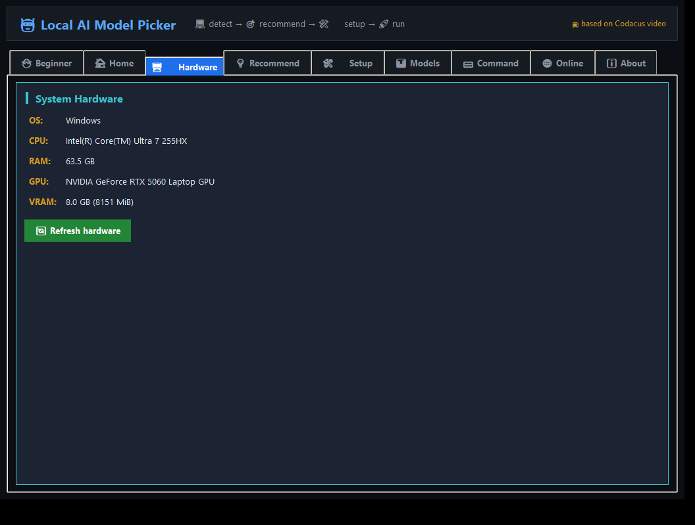
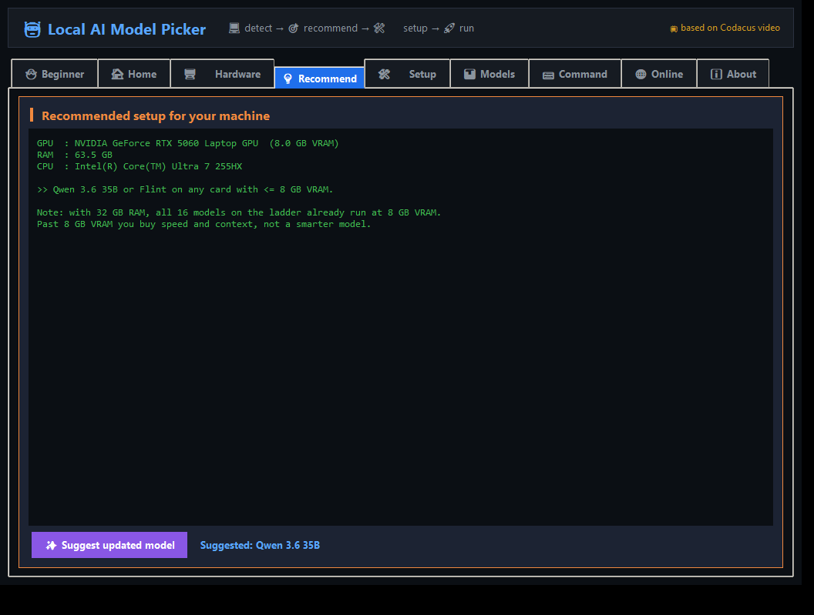
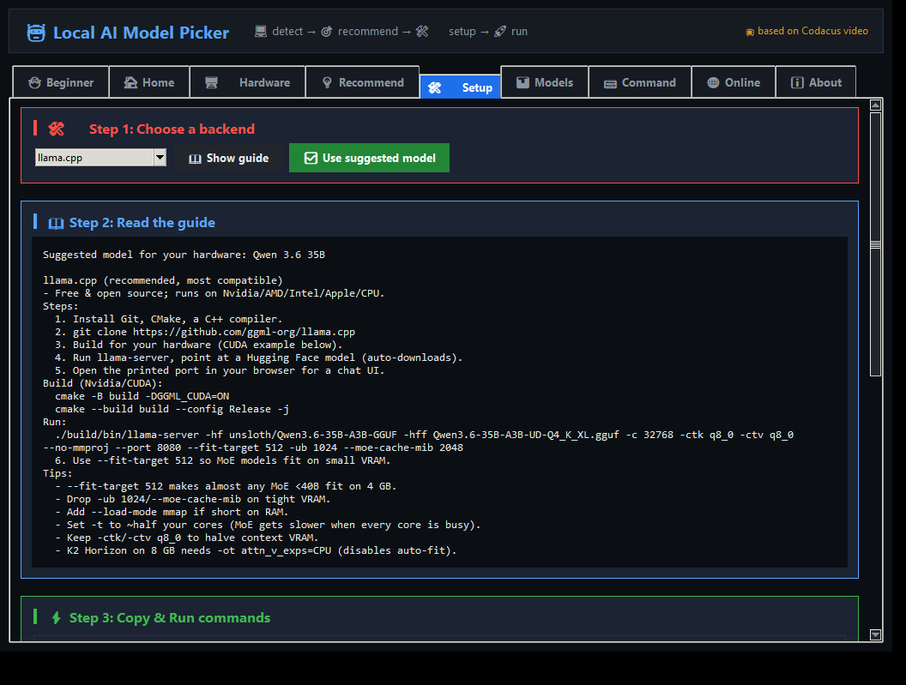
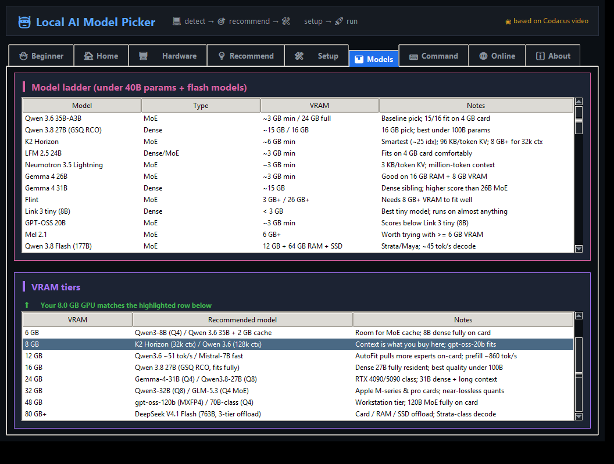
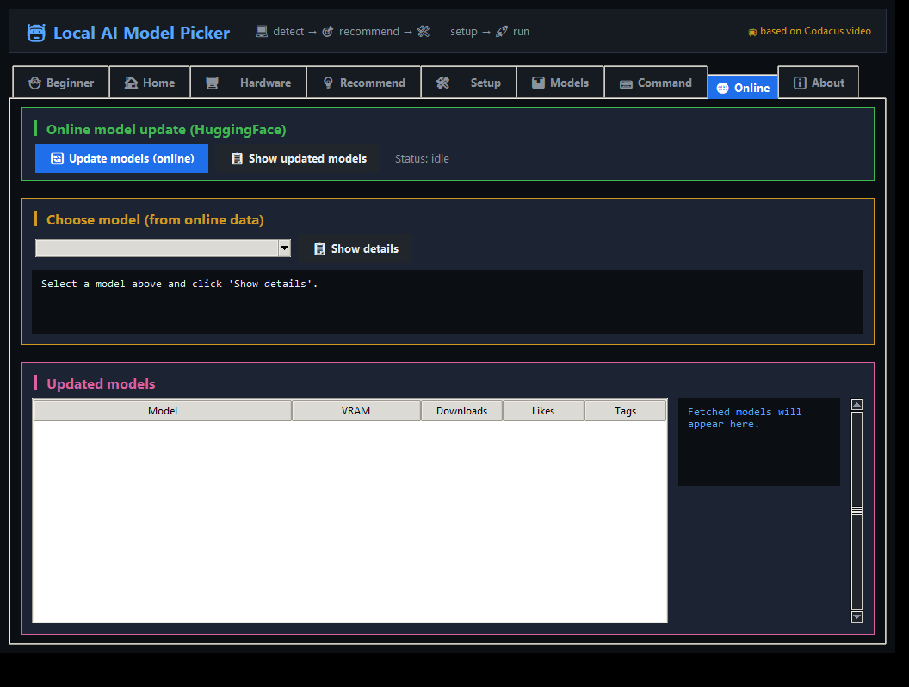

# 🐣 Beginner-Friendly Guide: Run Your First Local AI Model

Welcome! This guide is for people who have never run a local AI model before.
No prior experience needed. Follow the steps in order.

---

## 🧭 Step 1: Check your computer (2 minutes)

1. Download and double-click `LocalAIModelPicker.exe` (Windows) — no Python needed.
   - 🍎 macOS: run `run_mac.command` (first time: `chmod +x run_mac.command`).
   - 🐧 Linux: run `./run.sh`.
2. The app opens. Go to the **🖥️ Hardware** tab.
3. You will see your GPU, VRAM, RAM, and CPU detected automatically.

   - 💡 If VRAM shows 0, install your GPU drivers (Nvidia/AMD) and retry.
   - 🍎 Apple Silicon (M1/M2/M3/M4): VRAM = your total RAM (unified memory), so an M3 with 16 GB runs 16 GB-class models.

## 🎯 Step 2: Get a recommendation

1. Go to the **💡 Recommend** tab.
2. Read the recommendation for your machine.
3. Click **🔄 Suggest updated model** to refresh the suggestion.
4. Note the suggested model name (e.g. "Qwen 3.6 35B").

## 🛠️ Step 3: Pick a backend (easiest first)

For beginners, start with **Ollama** (no compiling needed):

1. Go to the **🛠️ Setup** tab.
2. Choose **Ollama** from the dropdown.
3. Read the guide (5 simple steps).

4. Download Ollama from https://ollama.com and install it.
5. Open a terminal and run:
   - `ollama pull qwen3.6:35b`
   - `ollama run qwen3.6:35b`
6. Chat with your model in the terminal!

## 🚀 Step 4: (Optional) Faster setup with llama.cpp

If you want more speed and control:

1. Choose **llama.cpp** in the Setup tab.
2. Follow the build steps (needs Git, CMake, C++ compiler).
3. Use the **Copy** / **Run** buttons to run commands directly.
4. Open the printed port in your browser for a chat UI.

## 📊 Step 5: Explore models

1. Go to **📊 Models** tab to see the model ladder.

2. Go to **🌐 Online** tab and click "Update models (online)" to see latest models from HuggingFace.

3. Pick a model that fits your VRAM (see VRAM column).

## ⌨️ Step 6: Copy & Run commands

- Every command has a **📋 Copy** and **▶ Run** button.
- Copy: puts the command in your clipboard.
- Run: opens a new terminal and runs it automatically.

## ❓ Common questions

**Q: My model is slow. What do I do?**
- Make sure experts are in RAM (auto-fit handles this).
- Add more RAM (32 GB recommended).
- Use a smaller quant (Q4 or Q3).

**Q: I get "out of memory".**
- Drop `-ub 1024` and `--moe-cache-mib 2048` from the command.
- Add `--load-mode mmap` if short on RAM.
- Use `--fit-target 512`.

**Q: Which model should I run first?**
- 4-6 GB VRAM: Link 3 tiny (8B) or Qwen 3.6 35B (with 32 GB RAM).
- 8 GB VRAM: K2 Horizon or Qwen 3.6 35B.
- 16 GB VRAM: Qwen 3.8 27B (best under 100B).

## 🆘 Need help?
- Check the **ℹ️ About** tab for credits and references.
- Visit the Discord: discord.gg/RBFFF898MB
- Watch the original video: https://www.youtube.com/watch?v=tek-IY9BRWc

Happy local AI! 🎉
