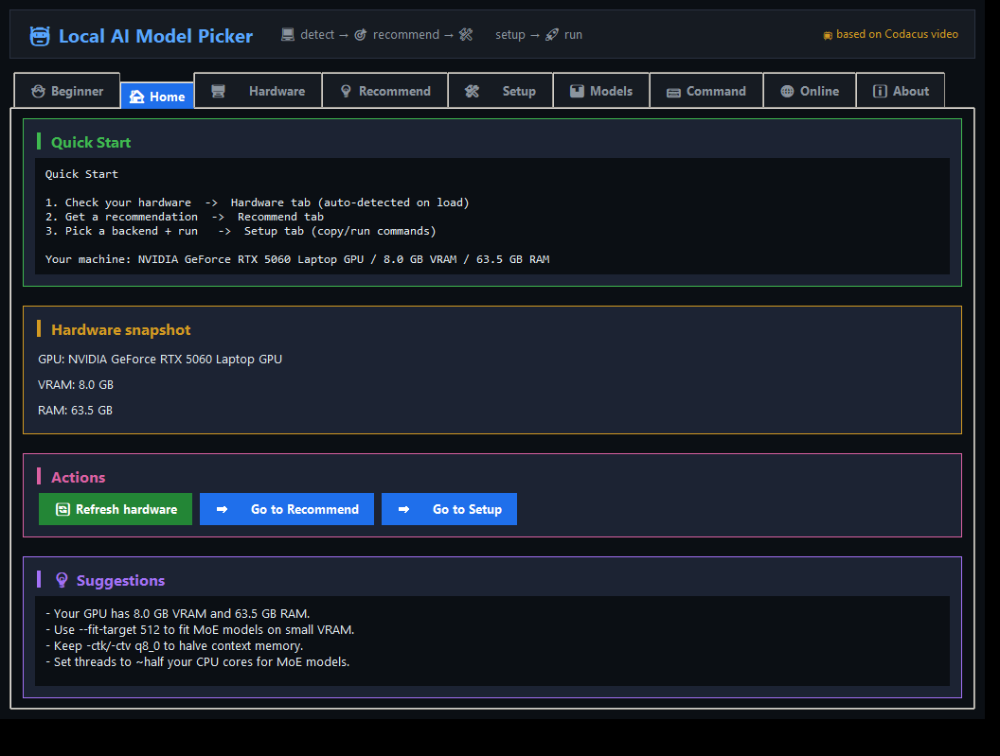

# 📖 Step-by-Step: Run Local AI Model Picker

## 🅰️ Option A - Windows (easiest, no Python needed)
1. 📂 Open the `dist` folder.
2. 🖱️ Double-click `LocalAIModelPicker.exe`.
3. 🖥️ The app opens as a desktop window.
4. Use tabs and buttons; `q` not needed (close window to exit).

## 🅱️ Option B - Windows (from source)
1. 🐍 Install Python 3.10+ from https://www.python.org/downloads/ (check "Add to PATH").
2. 🖱️ Double-click `run.bat` (or run `run.ps1` in PowerShell).
3. The script installs deps, then launches `gui.py`.

## 🅲 Option C - macOS / Linux
1. 🐍 Install Python 3.10+ (`brew install python` on macOS).
2. 📂 In Terminal: `cd /path/to/AI_Choice`
3. ▶️ Run `chmod +x run.sh && ./run.sh`

## 🎯 What the app does

- 🖥️ Hardware: detects your GPU/VRAM, RAM, CPU (auto on load)
- 💡 Recommend: picks a model + tier; click "Suggest updated model"
- 🛠️ Setup: step-by-step guides for 7 backends with copy/run commands
- 📊 Models: 45-model database + 10-tier VRAM ladder + live HuggingFace fetch (incl. uncensored)
- ⌨️ Command: starter command + notes + customize choice (model/backend dropdowns)
- 🏠 Home: quick start + hardware snapshot + actions
- ℹ️ About: creator (Nyi Min) + YouTube credit (https://www.youtube.com/watch?v=tek-IY9BRWc)

## ⌨️ Tips
- 🔄 Refresh hardware button updates detection + suggestion
- 📋 Copy / ▶ Run buttons for every command
- 🌐 "Update models (online)" fetches latest from HuggingFace
- 🖱️ All controls are clickable (native GUI, no web)

## 👤 Credits
- Creator: Nyi Min
- Reference: https://www.youtube.com/watch?v=tek-IY9BRWc (Codacus)
